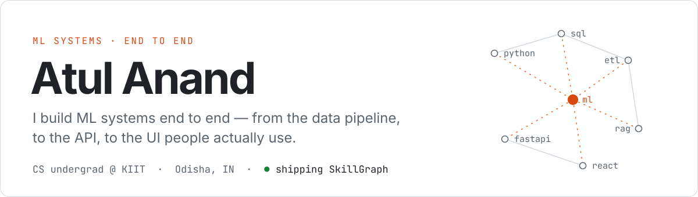
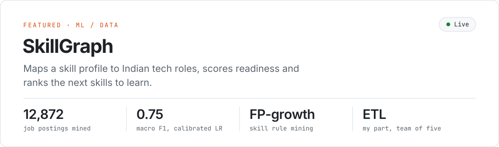
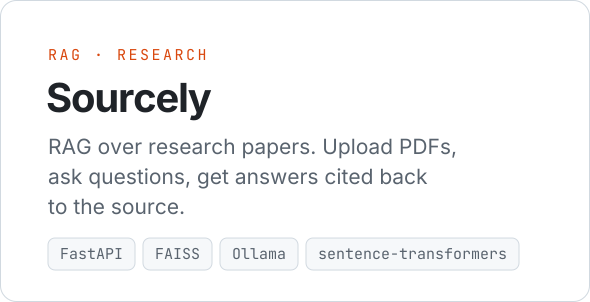
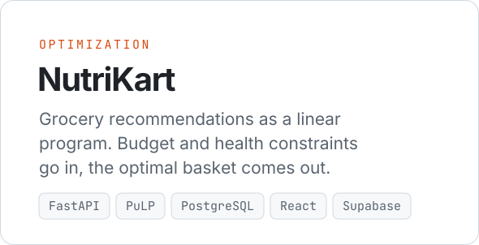

<picture>
  <source media="(prefers-color-scheme: dark)" srcset="./assets/header-dark.svg">
  
</picture>

  <a href="https://atulanand.co/tech"><code>atulanand.co/tech ↗</code></a>&nbsp;
  <a href="https://linkedin.com/in/atulacleaver"><code>LinkedIn ↗</code></a>&nbsp;
  <a href="https://twitter.com/atulacleaver"><code>X ↗</code></a>&nbsp;
  <a href="mailto:a2ulanand@gmail.com"><code>a2ulanand@gmail.com</code></a>

&nbsp;

### `01` &nbsp;Projects

<a href="https://github.com/AtulACleaver/SkillGraph">
  <picture>
    <source media="(prefers-color-scheme: dark)" srcset="./assets/skillgraph-dark.svg">
    
  </picture>
</a>

<a href="https://github.com/AtulACleaver/Sourcely"><picture><source media="(prefers-color-scheme: dark)" srcset="./assets/sourcely-dark.svg"></picture></a>
<a href="https://github.com/AtulACleaver/nutrikart"><picture><source media="(prefers-color-scheme: dark)" srcset="./assets/nutrikart-dark.svg"></picture></a>

SkillGraph is live at <a href="https://skillgraph-exp.vercel.app">skillgraph-exp.vercel.app</a> · Team of five, I own the ETL pipeline.

&nbsp;

### `02` &nbsp;Highlights

| Where | Result |
| :-- | :-- |
| **Smart India Hackathon** | Institutional semi-finalist, 500+ teams |
| **OpenAI × NxtWave Hackathon** | Cleared the qualifying round |
| **Notion Ambassador** | 11+ templates · 100K+ users · 7-figure revenue |
| **Notion Certified Admin** | Advanced, Essentials, Workflow |

&nbsp;

### `03` &nbsp;Stack

| Layer | Tools |
| :-- | :-- |
| **Languages** | `Python` `JavaScript` `Java` `C` `SQL` |
| **Backend** | `FastAPI` `PostgreSQL` `SQLAlchemy` `Supabase` |
| **Frontend** | `React` `Vite` `Tailwind CSS` |
| **ML** | `scikit-learn` `FAISS` `sentence-transformers` `OpenAI` `Ollama` |
| **Infra** | `Docker` `Vercel` `Render` `Git` |

&nbsp;

### `04` &nbsp;Activity

<picture>
  <source media="(prefers-color-scheme: dark)" srcset="https://raw.githubusercontent.com/AtulACleaver/AtulACleaver/output/github-snake-dark.svg">
  
</picture>
